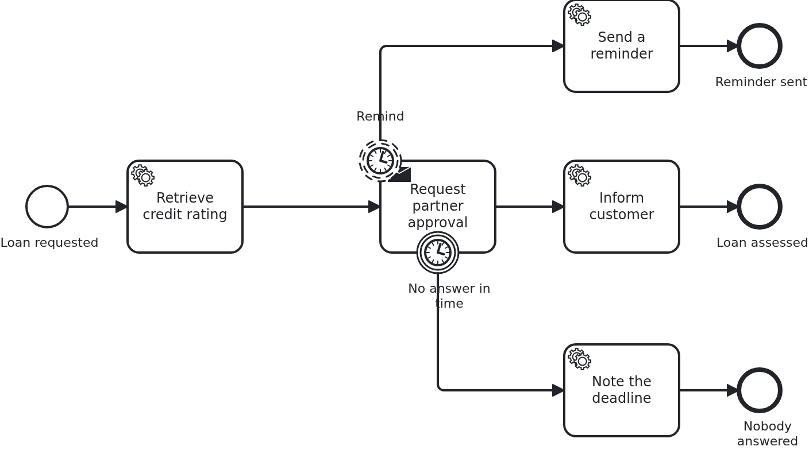

# Boundary events

[](./LICENSE)

Something happens while a task is open: a deadline passes, a reminder is due, a customer
withdraws. With a boundary event the process reacts to it. There are two kinds, and the
difference decides what your code has to handle. This blueprint puts both on the same task.

## What this blueprint shows



The loan approval of the base blueprint. A partner has to approve the loan. The task which asks
the partner carries two boundary events:

- **Non-interrupting** (`cancelActivity="false"`), the reminder. Its cycle asks for two
  repetitions while the task is open. It sends a reminder each time, and the task **stays
  open**. A token marks where a process instance currently is, and here it simply splits. The
  reminder branch runs to its own end event, and the main branch keeps waiting. How many
  reminders really go out before the deadline is up to the engine, and it differs. In our runs
  the embedded Camunda 7 sent one, the Camunda 8 cluster two.
- **Interrupting** (the default), the deadline. When it fires, the task is **canceled**. The
  workflow leaves it for good and takes the path behind the event.

For the application, the difference is what it has to handle:

- The non-interrupting one is an ordinary task on a side branch. Nothing is canceled, so
  nothing is reported as canceled. The task id the application kept still works afterwards. The
  test proves exactly that: it answers the task after a reminder went out.
- The interrupting one ends the wait. The open task is gone. The handler is called once more
  with `@TaskEvent CANCELED`, so it can drop what it kept. **Not every BPMS (business process
  management system) reports that**, so no code may rely on it. Answering a task that is gone
  does nothing either way.
  [The adapter's wiki page](https://github.com/vanillabp/adapter-platform-integration/wiki/BPMS-adapters)
  says which engines deliver cancellations. This blueprint asserts the cleared id only where it
  is delivered.

The two events also compete, and that is worth seeing. The reminder cycle is `R2/PT1S` and the
deadline `PT10S`. They are far enough apart that the order is not a matter of luck. Timers fire
when the BPMS gets to them. An engine which polls for due jobs may run two of them in one
sweep. If a process is only correct when one of two events comes first, it will surprise
somebody one day.

## Delta to the base blueprint

Compared to [`module-single`](https://github.com/vanillabp-blueprints/module-single-springboot):

|            File            |                                       What is different                                        |
|----------------------------|------------------------------------------------------------------------------------------------|
| `loan_approval.bpmn`       | a task waiting for a partner with TWO boundary events on it, one interrupting and one not      |
| `WorkflowTaskHandler.java` | the method of the waiting task plus one per branch behind an event                             |
| `Workflow.java`            | `completeTask` in addition to `startWorkflow`                                                  |
| `Service.java`             | sends the request, sends reminders while it waits, answers the task, notes a missed deadline   |
| `Aggregate.java`           | `partnerApprovalTaskId`, `remindersSent`, `timedOut`, and `@DynamicUpdate` for the side branch |
| `LoanApprovalIT.java`      | a reminder leaving the task open, an answer in time, and the deadline ending the wait          |
| `pom.xml`                  | hands the BPMS of the build to the tests, for the assertion about cancellations                |

## Running it

Requires a JDK 21 or newer. Camunda 7 is embedded, so nothing else has to run:

```bash
mvn install verify
```

To run it on another BPMS, pick another Maven profile. Not one line of Java changes:

```bash
mvn install verify -Pcamunda8
```

Camunda 8 is a remote engine, so a cluster has to run. Start one. Its address and everything
else specific to that engine are in its profile file
`application/src/main/resources/application-camunda8.yaml`. The module's own test has a copy:

```yaml
vanillabp:
  adapters:
    camunda8:
      # Camunda 8 is a remote engine: point this at your cluster.
      rest-address: http://localhost:8080
      # Camunda 8.10 can lose a leased job for a whole job-timeout. Until Camunda fixes that,
      # the adapter advises against a lease. The key has no default:
      # https://github.com/camunda-community-hub/vanillabp-camunda8-adapter/wiki/Configuration#a-job-somebody-else-holds
      job-lease: do-not-use
```

The blueprint does not lease its jobs. On 8.10 the gateway of the cluster can lose a leased
job when a long poll ends, and the job then waits for a whole `job-timeout`. Until Camunda
fixes that, the adapter advises `do-not-use`, and moving to `use` later costs nothing. Why is
[decision 88 of the Camunda 8 adapter](https://github.com/camunda-community-hub/vanillabp-camunda8-adapter/blob/main/DECISIONS.md#88-until-camunda-fixes-its-gateway-the-adapter-advises-against-a-lease-and-its-own-tests-keep-one).

The file is loaded because the Maven profile `camunda8` sets the Spring profile of the same
name. So you choose the engine once, on the Maven command line. The build, the tests and
`spring-boot:run` all follow it.

[Operaton](https://operaton.org), the open source successor of Camunda 7, is embedded as well
and needs nothing else either. The BPMN files are the ones of Camunda 7, because Operaton reads
their `camunda:` attributes:

```bash
mvn install verify -Poperaton
```

Start the application:

```bash
mvn -pl application spring-boot:run
```

You see nothing about identifiers at startup. The BPMS profiles of this blueprint set
`name-clash-avoidance: use-prefix`. So VanillaBP puts the workflow module ID in front of every
identifier before it reaches the engine, and takes it off again on the way back. The BPMN
files, the business code and the rest of the configuration keep the plain names. No tenant is
involved, which matters on a BPMS licensed per tenant.
[The wiki](https://github.com/vanillabp/adapter-platform-integration/wiki/Workflow-modules#how-name-clashes-are-avoided)
explains the modes and what each of them costs.

Start a loan approval. This is the only URL you need:

```
http://localhost:8080/api/loan-approval/start?amount=5000
```

The partner is asked, and from then on both clocks run:

```
Loan approval '0f7c…' started
Credit rating of loan approval '0f7c…' is 50
Partner was asked to approve loan approval '0f7c…' (5000 at a rating of 50)
Loan approval '0f7c…' waits for the partner, but not forever - the task carries a deadline of ten seconds, and reminders go out while it runs:
  Approved -> http://localhost:8080/api/loan-approval/0f7c…/partner-approved/1a2b…
```

Reminders go out while nothing happens, and the task stays open. The engine decides how many
arrive before the deadline:

```
Reminder 1 for loan approval '0f7c…' - the partner is still expected to answer
Reminder 2 for loan approval '0f7c…' - the partner is still expected to answer
```

Open the URL any time before the deadline, and the answer is still accepted:

```
The partner approved loan approval '0f7c…'
The customer of loan approval '0f7c…' was informed
```

Wait longer, and the interrupting event ends the wait:

```
The partner request of loan approval '4b21…' was canceled
Nobody answered for loan approval '4b21…' in time
```

The first of those two lines is the cancellation. It reaches the same handler that sent the
request, on a BPMS that reports cancellations. If you open the URL afterwards, the answer is
that this request is not open any more. The application decides that on its own.

Camunda 7 serves its own web applications, and the `camunda7` profile of this blueprint
configures a user for them. They show both tokens while the reminder branch runs, which is the
clearest picture of what non-interrupting means. Where they are served and how to log in is in
the
[adapter's wiki](https://github.com/camunda-community-hub/vanillabp-camunda7-adapter/wiki/Cockpit-Tasklist-and-Admin).

## How it works

|                                          File                                          |                                              Role                                              |
|----------------------------------------------------------------------------------------|------------------------------------------------------------------------------------------------|
| `loan-approval/src/main/resources/loan-approval/processes/camunda7/loan_approval.bpmn` | the process: one waiting task carrying a non-interrupting and an interrupting boundary event   |
| `.../loanapproval/WorkflowTaskHandler.java`                                            | the method of the waiting task: `@TaskId` to keep, `@TaskEvent` to hear about the cancellation |
| `.../loanapproval/Service.java`                                                        | asks the partner once, answers the task, and notes a missed deadline                           |
| `.../loanapproval/Workflow.java`                                                       | `completeTask`, the only place `ProcessService` is used                                        |
| `.../loanapproval/model/Aggregate.java`                                                | the task id, the answer and whether the deadline ran out                                       |
| `loan-approval/src/test/.../LoanApprovalIT.java`                                       | answered in time, and not answered at all                                                      |

What the two events have in common: the BPMS decides when they fire, and the application only
receives the work. The token separates them. A non-interrupting event adds one, so the reminder
runs beside a task which is still open. An interrupting event takes the token away from the
task, and that makes the task disappear.

Think about that extra token before you model one. It is why `Aggregate` carries
`@DynamicUpdate`. Two branches of the same workflow run at the same time, and both save the
aggregate. The reminder saves it in a transaction of the BPMS, the answer in one the
application opened. Writing different attributes does not keep them apart by itself, because
JPA (Jakarta Persistence) saves the whole row. The branch which commits second writes back the
values it read at its start. What the other branch committed in between is gone. There is no
exception and no log line. The process behaves exactly as modelled, but the data does not.

`@DynamicUpdate` makes Hibernate write only the columns a branch changed. That is enough here:
the reminder counts, and the answer writes the answer. Two branches which write the SAME
attribute are a different problem. That needs a `@Version` column, or a model which does not do
it. This cost a red CI job before anybody understood it. The framework describes the second
writer and the ways to deal with it under
[Two writers on one aggregate](https://github.com/vanillabp/adapter-platform-integration/wiki/Workflow-aggregates#two-writers-on-one-aggregate).

The tests wait for the aggregate, not for a clock. A timer fires when the BPMS gets to it. So a
test that sleeps for exactly three seconds fails on a slow machine.

## Documentation

- [Workflow tasks](https://github.com/vanillabp/adapter-platform-integration/wiki/Workflow-tasks#parameters): `@TaskId` and `@TaskEvent`, and what a lifecycle event delivers
- [Completing and canceling asynchronous tasks](https://github.com/vanillabp/adapter-platform-integration/wiki/Workflow-tasks#completing-and-canceling-asynchronous-tasks): the rules the answer follows, and what happens to a task that is gone
- [BPMS adapters](https://github.com/vanillabp/adapter-platform-integration/wiki/BPMS-adapters): which engine reports a cancellation to the application, and which does not
- the wiki of the BPMS adapter you use: how it executes timers, and whether it reports a canceled task to the application

This blueprint is developed in the monorepo
[`blueprints`](https://github.com/vanillabp-blueprints/blueprints). This repository is a
read-only mirror, **issues and pull requests belong there.**

## Noteworthy & Contributors

[VanillaBP](https://www.github.com/vanillabp/spi-for-java) was developed by [Phactum](https://www.phactum.at) with the
intention of giving back to the community as it has benefited the community in the past.


## License

Copyright 2026 Phactum Softwareentwicklung GmbH

Licensed under the Apache License, Version 2.0
